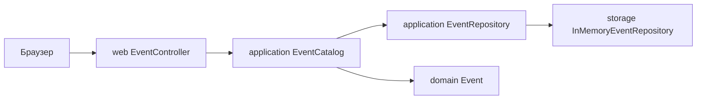

# План Event Studio

## Проблема и пользователи

Организатору небольшого мероприятия нужно хранить программу, услуги и бронирования в одном месте. Event Studio позволит настроить мероприятие и пакет, рассчитать бронирование, увидеть изменение статуса и сохранить итоговую сводку. Пользователи — организатор и участник.

**Стек:** Java 21+ для бизнес-логики и локального HTTP-сервера `jdk.httpserver`; HTML/CSS для браузерного интерфейса. В первом срезе нет внешних зависимостей. Данные пока хранятся в памяти; постоянное хранение обязательно до финала.

## Пользовательские сценарии

1. Создать мероприятие с типом, датой и числом мест. **Работает.**
2. Просмотреть список и изменить мероприятие. **Работает.**
3. Собрать пакет услуг и добавить опции. **Планируется.**
4. Выбрать пакет и способ расчёта, оформить бронирование. **Планируется.**
5. Подтвердить или отменить бронирование и увидеть реакцию. **Планируется.**
6. Перезапустить приложение и увидеть сохранённые данные. **Планируется.**
7. Просмотреть и экспортировать итоговую сводку. **Планируется.**

Полный путь: создать мероприятие → настроить пакет → выбрать расчёт → оформить бронирование → увидеть изменение статуса → экспортировать сводку.

## Сущности

| Сущность | Связь и назначение |
| --- | --- |
| `Event` | Мероприятие с типом, датой и вместимостью. |
| `ServicePackage` | Пакет услуг для конкретного `Event`. |
| `Participant` | Человек, оформляющий бронирование. |
| `Booking` | Связывает `Event`, `ServicePackage` и `Participant`; имеет статус. |

Структуры есть в коде. Пользовательские операции пока реализованы только для `Event`.

## Архитектура и контракты

- `EventCatalog.create(title, date, capacity, type)` проверяет ввод и создаёт мероприятие. Асанали заменит прямой вызов конструктора своей реализацией Factory Method.
- `EventCatalog.update(id, ...)`, `find(id)` и `list()` задают базовые операции с мероприятиями.
- `EventRepository` содержит `findAll`, `findById` и `save`. Постоянное хранилище заменит текущую реализацию без изменения UI.
- `EventController` преобразует HTTP-формы в вызовы бизнес-логики и показывает ошибки. В нём не должно быть правил ценообразования или бронирования.
- Асанали самостоятельно создаст Facade для главного пути после определения операций с пакетами и бронированиями. Facade должна координировать несколько реальных сервисов; простое переименование `EventCatalog` не считается паттерном.
- Дальнейшие бизнес-правила добавлять в `application`, модели в `domain`, хранилища в `storage`, обработчики и страницы в `web`. `web` не обращается напрямую к хранилищу.

## Паттерны и владельцы

| Участник | Паттерны | Реальная роль в Event Studio |
| --- | --- | --- |
| Асанали | Factory Method, Facade | Варианты мероприятия с различными правилами; координация создания, настройки и бронирования. |
| Амир | Strategy, Observer | Выбор способа расчёта; реакция на изменение статуса бронирования. |
| Бакытжан | Builder, Decorator | Пошаговая сборка пакета; дополнительные услуги с изменением цены/описания. |
| Рустам | Adapter, Visitor | Импорт внешнего формата; сводка по мероприятиям, пакетам и бронированиям. |

Каждый паттерн должен быть вызван через GUI. Если он не решает реальной задачи, команда согласует замену до реализации. В отчёте для каждого нужны проблема, классы/интерфейсы, демонстрация и ответственный студент.

## Эскиз интерфейса

Текущий экран: форма создания слева и список мероприятий справа; отдельная форма редактирования. Следующие панели: настройка пакета, бронирование и расчёт, журнал событий, итоговая сводка и экспорт. На узком экране колонки становятся вертикальными.

## Контрольные точки

- Неделя 1: тема, сценарии, эскиз GUI, паттерны, первичная UML и каркас.
- Неделя 2: полный путь через GUI, интеграция паттернов, постоянное хранение.
- Неделя 3: ошибки, восемь тестовых сценариев, три автоматизированных теста, демонстрационные данные, финальные UML, отчёт и защита.

ИИ помогал подготовить каркас и эту документацию. Каждый участник самостоятельно реализует свои два паттерна, проверяет их и указывает использование ИИ в отчёте.
