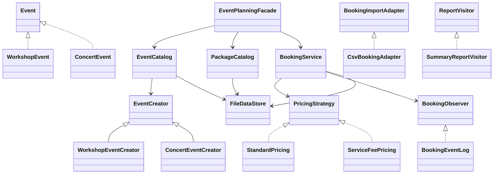
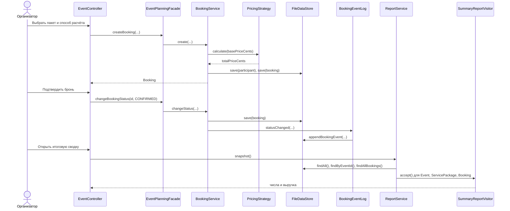

# UML и поток вызовов

Диаграммы отражают текущий код. Пакет пока стартовый; Builder и Decorator Бакытжана ещё не добавлены.

## Диаграмма классов

## Диаграмма последовательности: бронирование и итог

